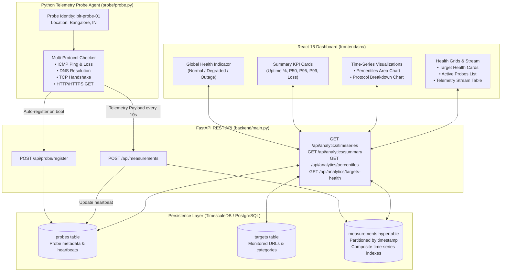
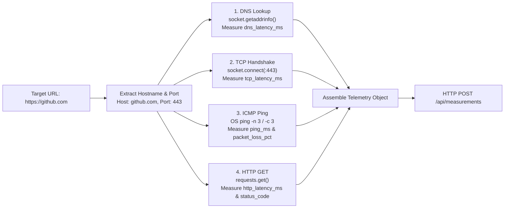
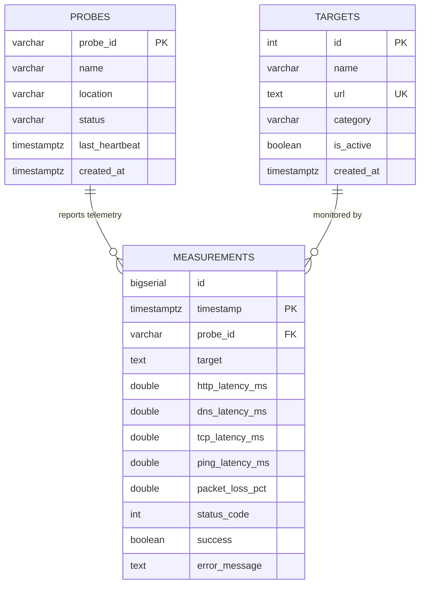
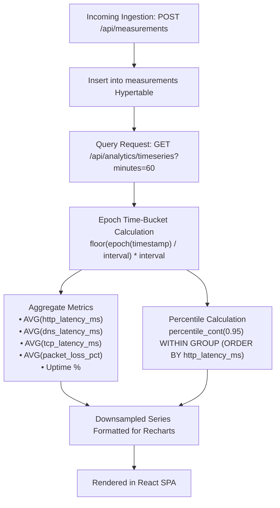
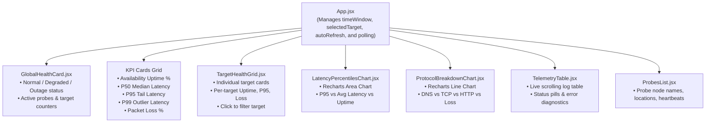

# 🌐 Internet Outage & Reliability Intelligence Platform — Version 2
## System Architecture & Technical Specification Document

> **Confined exclusively to Version 2 (Stage 2: Real Time-Series System)**

---

## 📑 Table of Contents

1. [Executive Summary: What is Version 2?](#1-executive-summary-what-is-version-2)
2. [Why Version 2: Evolution from Version 1](#2-why-version-2-evolution-from-version-1)
3. [V2 Block Diagrams & Architecture](#3-v2-block-diagrams--architecture)
   - [3.1 High-Level System Architecture](#31-high-level-system-architecture)
   - [3.2 Multi-Protocol Telemetry Probe Flow](#32-multi-protocol-telemetry-probe-flow)
   - [3.3 Time-Series & Relational Data Model (ERD)](#33-time-series--relational-data-model-erd)
   - [3.4 Real-Time Analytics & Percentile Engine Pipeline](#34-real-time-analytics--percentile-engine-pipeline)
   - [3.5 Frontend UI Component & Data Flow Hierarchy](#35-frontend-ui-component--data-flow-hierarchy)
4. [Component 1: Multi-Protocol Probe Agent](#4-component-1-multi-protocol-probe-agent)
5. [Component 2: FastAPI Telemetry & Analytics Engine](#5-component-2-fastapi-telemetry--analytics-engine)
6. [Component 3: Storage Engine (TimescaleDB & PostgreSQL)](#6-component-3-storage-engine-timescaledb--postgresql)
7. [Component 4: React Observability Dashboard](#7-component-4-react-observability-dashboard)
8. [Failure Modes & SDE Defensive Engineering in V2](#8-failure-modes--sde-defensive-engineering-in-v2)
9. [Step-by-Step V2 Execution Guide](#9-step-by-step-v2-execution-guide)

---

## 1. Executive Summary: What is Version 2?

**Version 2** transforms the platform from a rudimentary ping monitor into a **specialized, multi-protocol time-series intelligence system**.

### The Core Goal of V2
Rather than only asking *"did this URL respond to an HTTP request?"*, Version 2 dissects network performance across four core protocol layers:
- **ICMP**: Round-trip ping time and packet loss percentage ($0\%$ to $100\%$).
- **DNS**: Domain resolution latency and resolution failures.
- **TCP**: Socket connection handshake latency to port 443/80.
- **HTTP/HTTPS**: Full application-layer response time and HTTP status codes.

Version 2 also introduces a **TimescaleDB time-partitioned hypertable**, **true latency percentiles** ($P_{50}, P_{90}, P_{95}, P_{99}$), **dynamic time-window filtering** (15m, 1h, 6h, 24h), and **probe node registration with heartbeat tracking**.

---

## 2. Why Version 2: Evolution from Version 1

| Capability | Version 1 (MVP) | Version 2 (Real Time-Series System) |
| :--- | :--- | :--- |
| **Telemetry Depth** | HTTP response time only | **4-Protocol Decomposition**: DNS lookup, TCP handshake, ICMP packet drop %, HTTP response |
| **Database Structure** | Single flat measurements table | **Decoupled Architecture**: Application metadata (`probes`, `targets`) separated from time-series `measurements` |
| **Storage Engine** | Standard relational table | **TimescaleDB Hypertable** partitioning with automated fallback for vanilla PostgreSQL |
| **Statistical Metrics** | Simple arithmetic average | True **Percentile Analytics** ($P_{50}$ median, $P_{90}$, $P_{95}$, $P_{99}$ tail latency) via SQL `percentile_cont` |
| **Historical Windows** | Last $N$ records only | **Dynamic Time-Window Filtering**: Aggregations across 15 minutes, 1 hour, 6 hours, 24 hours |
| **Probe Management** | Anonymous metric uploads | **Explicit Registration & Heartbeats**: Probe identity (`blr-probe-01`), geographic locations, alive status |
| **User Interface** | Basic single-line chart & table | **Full Observability Dashboard**: Protocol breakdown charts, percentile area plots, target health grid |

---

## 3. V2 Block Diagrams & Architecture

### 3.1 High-Level System Architecture



---

### 3.2 Multi-Protocol Telemetry Probe Flow



---

### 3.3 Time-Series & Relational Data Model (ERD)



---

### 3.4 Real-Time Analytics & Percentile Engine Pipeline



---

### 3.5 Frontend UI Component & Data Flow Hierarchy



---

## 4. Component 1: Multi-Protocol Probe Agent

The probe agent (`probe/probe.py`) is an autonomous background process designed to collect accurate diagnostic metrics without imposing excessive overhead on monitored targets.

### Protocol Checks Detailed:
1. **DNS Resolution Check**:
   - Uses `socket.getaddrinfo(hostname, None)`.
   - Measures time to resolve domain name into IP addresses with high-resolution performance timers (`time.perf_counter()`).
   - Captures NXDOMAIN, DNS timeouts, or local resolver failures.
2. **TCP Connection Handshake Check**:
   - Opens a TCP socket to `(hostname, 443)` (or port 80 for HTTP endpoints).
   - Isolates network transport handshake latency from application processing time.
3. **ICMP Ping & Packet Loss Measurement**:
   - Executes an OS-level ping subprocess (3 packets with 1-second timeout).
   - Compatible with Windows (`ping -n 3 -w 1000`) and Linux/macOS (`ping -c 3 -W 1`).
   - Computes packet loss percentage: $0\%$, $33\%$, $66\%$, or $100\%$.
4. **HTTP / HTTPS Application Check**:
   - Executes an HTTP GET request using `requests.get()`.
   - Records total round-trip time, HTTP status code (200, 301, 502, etc.), and error details.
5. **Probe Lifecycle & Heartbeats**:
   - On startup, the probe calls `POST /api/probe/register` to register its identity (`blr-probe-01`), descriptive name (`Bangalore Primary Probe`), and location (`Bangalore, IN`).
   - Every telemetry check updates the probe's heartbeat timestamp in the database.

---

## 5. Component 2: FastAPI Telemetry & Analytics Engine

The backend API (`backend/main.py`) provides high-performance endpoints for telemetry ingestion and real-time analytical queries.

### Key API Endpoints in V2:

#### 1. Ingestion: `POST /api/measurements`
- Validates payload against Pydantic schema `MeasurementCreate`.
- Inserts multi-protocol metrics into PostgreSQL / TimescaleDB.
- Automatically refreshes the probe's `last_heartbeat` and marks it `active`.

#### 2. Summary Reliability KPIs: `GET /api/analytics/summary`
- Parameter: `minutes` (default: 60).
- Computes aggregate availability uptime %, average HTTP, DNS, and TCP latency, average packet loss %, and exact $P_{50}$, $P_{95}$, and $P_{99}$ latency values using SQL `percentile_cont`.

#### 3. Time-Series Downsampling: `GET /api/analytics/timeseries`
- Parameters: `minutes` (15, 60, 360, 1440), optional `target`.
- Dynamically buckets time using PostgreSQL epoch arithmetic:
  ```sql
  to_timestamp(floor(extract(epoch from timestamp) / :bucket_seconds) * :bucket_seconds)
  ```
- Returns aggregated average latencies, $P_{95}$ tail latency, packet loss %, and uptime % per bucket for smooth charting.

#### 4. Target Health Breakdown: `GET /api/analytics/targets-health`
- Calculates individual health statistics for every monitored target over the requested time window.
- Powers the interactive target health cards in the UI.

#### 5. Probe Management: `GET /api/probes` & `POST /api/probe/register`
- Returns active probe agents, locations, status, and last heartbeat timestamps.

---

## 6. Component 3: Storage Engine (TimescaleDB & PostgreSQL)

### Separation of Concerns
Version 2 separates application data from high-throughput time-series data:
- **`probes` Table**: Stores registered probe nodes and heartbeats.
- **`targets` Table**: Stores monitored endpoints (`Google`, `GitHub`, `Cloudflare`, `AWS`, `YouTube`).
- **`measurements` Table**: Stores time-stamped metric records.

### TimescaleDB Hypertable & PostgreSQL Fallback
- In `backend/database.py`, the system attempts:
  ```sql
  CREATE EXTENSION IF NOT EXISTS timescaledb CASCADE;
  SELECT create_hypertable('measurements', 'timestamp', if_not_exists => TRUE);
  ```
- If running on TimescaleDB, the table is automatically partitioned into daily chunks with optimized time-series storage.
- If running on vanilla PostgreSQL, the system catches the absence of the extension and configures composite B-Tree indexes:
  - `idx_measurements_ts_target (timestamp DESC, target)`
  - `idx_measurements_probe_ts (probe_id, timestamp DESC)`
  - `idx_measurements_success_ts (success, timestamp DESC)`

### Advanced Continuous Aggregates (`backend/timescaledb_setup.sql`)
For production TimescaleDB setups, a pre-computed 1-minute continuous aggregate view is provided:
```sql
CREATE MATERIALIZED VIEW measurements_1m_rollup
WITH (timescaledb.continuous) AS
SELECT
    time_bucket('1 minute', timestamp) AS bucket,
    target,
    probe_id,
    COUNT(*) as total_samples,
    AVG(http_latency_ms) as avg_http,
    percentile_cont(0.50) WITHIN GROUP (ORDER BY http_latency_ms) as p50,
    percentile_cont(0.95) WITHIN GROUP (ORDER BY http_latency_ms) as p95
FROM measurements
GROUP BY bucket, target, probe_id;
```

---

## 7. Component 4: React Observability Dashboard

Built with **React 18 + JavaScript** (no TypeScript) and **Recharts**.

### UI Features:
1. **Global Health Banner**: Evaluates uptime %, packet loss %, and $P_{95}$ latency to display:
   - 🟢 **Normal Operational** (Uptime $\ge 98\%$, Packet Loss $\le 2\%$)
   - 🟡 **Performance Degraded** (Elevated latency or minor loss)
   - 🔴 **Outage Detected** (Uptime $< 90\%$ or severe packet drop)
2. **KPI Cards Grid**: Cards showing Uptime %, $P_{50}$ Median Latency, $P_{95}$ Tail Latency, $P_{99}$ Outlier Latency, and Avg Packet Loss %.
3. **Latency Trends & Tail Percentiles Chart**: Recharts area chart comparing average HTTP response time against $P_{95}$ tail latency over time.
4. **Protocol Decomposition Chart**: Multi-line visualization comparing DNS Resolution, TCP Handshake, HTTP Latency, and Packet Loss %.
5. **Target Health Grid**: Interactive cards for each target endpoint. Clicking a target card filters the entire dashboard to that specific target.
6. **Active Telemetry Probes Panel**: Displays probe locations (`Bangalore, IN`), ID badges, and live heartbeat timestamps.
7. **Real-Time Telemetry Stream Table**: Live table displaying the latest 100 measurements with protocol metrics, HTTP status codes, and error badges.

---

## 8. Failure Modes & SDE Defensive Engineering in V2

1. **Probe Heartbeat Dead-Man Switch**:
   - Each probe reports heartbeats on every cycle.
   - If a probe ceases reporting, its status remains tracked by `last_heartbeat`. Missing data is never falsely classified as an external internet outage.
2. **Network Timeout Isolation**:
   - DNS, TCP, Ping, and HTTP checks use independent timeouts (3.0s–5.0s).
   - If a target's DNS hangs, it times out gracefully without blocking checks against other endpoints.
3. **Graceful Database Migration**:
   - `backend/database.py` contains automated schema evolution (`ALTER TABLE ADD COLUMN IF NOT EXISTS`) that safely upgrades existing V1 database tables to V2 without data loss.

---

## 9. Step-by-Step V2 Execution Guide

### 1. Database
Ensure PostgreSQL is active on port 5432 with database `outage_db`.
*(Alternatively run `docker-compose -f docker-compose.timescale.yml up -d` for TimescaleDB).*

### 2. Backend API
```powershell
cd Internet_Outage_Relaibility_2\backend
.\.venv\Scripts\Activate.ps1
uvicorn main:app --reload --port 8000
```

### 3. Probe Worker
```powershell
cd Internet_Outage_Relaibility_2\probe
.\.venv\Scripts\Activate.ps1
python probe.py
```

### 4. React Frontend
```powershell
cd Internet_Outage_Relaibility_2\frontend
npm run dev
```
Open `http://localhost:5173` in your browser.
