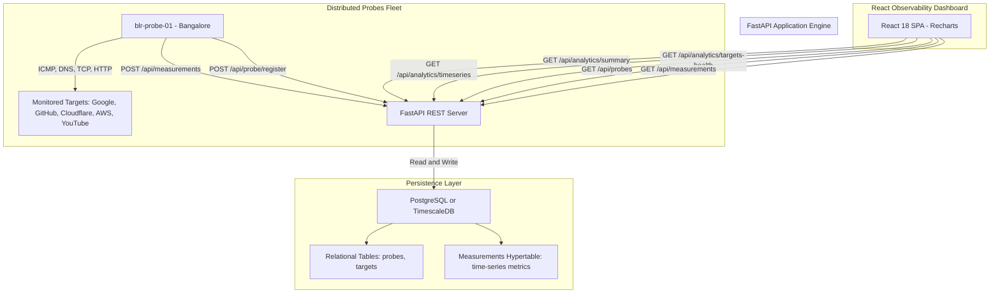

# 🌐 Internet Outage & Reliability Intelligence Platform — Stage 2

> **Stage 2: Real Time-Series System** — A distributed multi-protocol telemetry and internet reliability platform featuring TimescaleDB / PostgreSQL time-series architecture, latency percentiles (`P50`, `P90`, `P95`, `P99`), DNS/TCP/HTTP latency decomposition, ICMP packet loss tracking, probe heartbeats, and an interactive React dashboard.

---

## 📋 Table of Contents

- [Overview & What's New in Stage 2](#-overview--whats-new-in-stage-2)
- [System Architecture](#-system-architecture)
- [Multi-Tier Telemetry Engine](#-multi-tier-telemetry-engine)
- [Time-Series & Database Design](#-time-series--database-design)
  - [Application Tables](#application-tables)
  - [Measurements Hypertable](#measurements-hypertable)
  - [TimescaleDB Continuous Aggregates](#timescaledb-continuous-aggregates)
- [Tech Stack](#-tech-stack)
- [Repository Structure](#-repository-structure)
- [Quick Start Guide](#-quick-start-guide)
  - [1. Database Setup (PostgreSQL or TimescaleDB)](#1-database-setup-postgresql-or-timescaledb)
  - [2. Backend Setup (FastAPI)](#2-backend-setup-fastapi)
  - [3. Telemetry Probe Setup (Python)](#3-telemetry-probe-setup-python)
  - [4. Frontend Setup (React + Vite)](#4-frontend-setup-react--vite)
- [REST API Reference](#-rest-api-reference)
- [In-Depth System Architecture](#-in-depth-system-architecture)
- [License](#-license)

---

## 🔍 Overview & What's New in Stage 2

In **Stage 1 (MVP)**, the system performed basic HTTP ping checks against three endpoints, stored flat rows in a standard database table, and plotted a single latency line.

**Stage 2 elevates the platform into a true time-series telemetry system:**

| Feature | Stage 1 (MVP) | Stage 2 (Time-Series System) |
| :--- | :--- | :--- |
| **Telemetry Depth** | HTTP response time only | **4-Layer Protocol Decomposition**: DNS resolution time, TCP connection handshake, ICMP ping latency & packet loss %, HTTP latency & status |
| **Data Architecture** | Single flat measurements table | **Decoupled Architecture**: Domain tables (`probes`, `targets`) separated from high-throughput time-series `measurements` |
| **Time-Series Storage** | Standard relational table | **TimescaleDB Hypertable** partitioning with automated indexing and fallback for vanilla PostgreSQL |
| **Analytics Engine** | Arithmetic average | **Percentile Analytics**: True `P50` (median), `P90`, `P95`, and `P99` tail latency metrics |
| **Time Windows** | Last N records only | **Dynamic Time-Window Filtering**: Downsampled historical aggregations (15 mins, 1 hour, 6 hours, 24 hours) |
| **Probe Management** | Anonymous pings | **Probe Registration & Heartbeats**: Node registration, geographic locations, and alive status |
| **Frontend UI** | Basic line chart | **Comprehensive Observability Suite**: Global health banner, latency percentile area charts, protocol breakdown comparisons, target health grid |

---

## 🏗️ System Architecture



---

## 📡 Multi-Tier Telemetry Engine

Rather than simply timing a web page download, the Stage 2 probe executes a multi-protocol diagnostic check against each target endpoint:

```
Target URL: https://github.com
  │
  ├── 1. DNS Resolution (socket.getaddrinfo)
  │      └── Measures lookup time in ms (detects DNS propagation / resolver failure)
  │
  ├── 2. TCP Handshake (socket.connect to :443)
  │      └── Measures network transport handshake latency
  │
  ├── 3. ICMP Ping & Packet Loss (OS ping -n 3 / -c 3)
  │      └── Measures round-trip ping time and calculates dropped packet %
  │
  └── 4. HTTP/HTTPS GET (requests.get)
         └── Captures end-to-end response time, HTTP status code (200, 502, etc.), and SSL/TLS errors
```

---

## 🗄️ Time-Series & Database Design

### Application Tables
- **`probes`**: Stores registered probe identifiers, descriptive names, geographic locations, and dynamic heartbeat timestamps.
- **`targets`**: Stores monitored URLs, service categories (e.g. Developer Platform, Cloud Infrastructure, Anycast DNS), and activation state.

### Measurements Hypertable
The `measurements` table is partitioned by `timestamp`:
```sql
CREATE TABLE IF NOT EXISTS measurements (
    id BIGSERIAL,
    timestamp TIMESTAMP WITH TIME ZONE NOT NULL DEFAULT CURRENT_TIMESTAMP,
    probe_id VARCHAR(64) NOT NULL,
    target TEXT NOT NULL,
    http_latency_ms DOUBLE PRECISION,
    dns_latency_ms DOUBLE PRECISION,
    tcp_latency_ms DOUBLE PRECISION,
    ping_latency_ms DOUBLE PRECISION,
    packet_loss_pct DOUBLE PRECISION DEFAULT 0.0,
    status_code INT,
    success BOOLEAN NOT NULL,
    error_message TEXT
);

-- Converted to TimescaleDB hypertable if TimescaleDB extension is active:
SELECT create_hypertable('measurements', 'timestamp', if_not_exists => TRUE);
```

### TimescaleDB Continuous Aggregates
For high-scale installations, `backend/timescaledb_setup.sql` defines 1-minute continuous rollups:
```sql
CREATE MATERIALIZED VIEW measurements_1m_rollup
WITH (timescaledb.continuous) AS
SELECT
    time_bucket('1 minute', timestamp) AS bucket,
    target,
    probe_id,
    COUNT(*) as total_samples,
    AVG(http_latency_ms) as avg_http_latency,
    percentile_cont(0.50) WITHIN GROUP (ORDER BY http_latency_ms) as p50_latency,
    percentile_cont(0.95) WITHIN GROUP (ORDER BY http_latency_ms) as p95_latency
FROM measurements
GROUP BY bucket, target, probe_id;
```

---

## 💻 Tech Stack

| Layer | Technology | Purpose |
| :--- | :--- | :--- |
| **Frontend** | React 18, Vite, Recharts, JavaScript, CSS3 | Real-time observability dashboard with percentiles, protocol charts, and target health |
| **Backend** | Python 3.11+, FastAPI, Pydantic v2, Uvicorn | High-performance async REST API and analytics calculator |
| **Database** | PostgreSQL 14+ / TimescaleDB, `psycopg 3` | Time-series hypertable storage with percentile functions (`percentile_cont`) |
| **Telemetry Probe** | Python 3, `socket`, `requests`, `subprocess` | Multi-protocol probe measuring DNS, TCP, ICMP packet loss, and HTTP response |
| **Containerization** | Docker Compose | Optional single-command TimescaleDB deployment |

---

## 📁 Repository Structure

```text
Internet_Outage_Relaibility_2/
├── backend/
│   ├── database.py                 # PostgreSQL / TimescaleDB connection manager & hypertable init
│   ├── main.py                     # FastAPI REST API with percentiles & time-series endpoints
│   ├── schemas.py                  # Pydantic v2 validation models
│   ├── requirements.txt            # Python dependencies (fastapi, psycopg, pydantic)
│   ├── .env                        # Database connection settings
│   └── timescaledb_setup.sql       # Advanced hypertable & continuous aggregate schema
├── probe/
│   ├── probe.py                    # Multi-protocol probe (DNS, TCP, ICMP ping, HTTP)
│   ├── requirements.txt            # Probe dependencies
│   └── .env                        # Probe configuration (ID, interval, targets)
├── frontend/
│   ├── index.html                  # Vite application root
│   ├── package.json                # React & Recharts dependencies
│   ├── vite.config.js              # Vite server configuration
│   └── src/
│       ├── main.jsx                # React bootstrap
│       ├── App.jsx                 # Dashboard state, window selector & polling loop
│       ├── App.css                 # Dark theme observability styling
│       └── components/
│           ├── GlobalHealthCard.jsx          # System health banner & KPI indicators
│           ├── LatencyPercentilesChart.jsx   # P50, P95 & Avg latency Recharts area graph
│           ├── ProtocolBreakdownChart.jsx    # DNS vs TCP vs HTTP latency breakdown
│           ├── TargetHealthGrid.jsx          # Individual target reliability cards
│           ├── ProbesList.jsx                # Active probe agents & heartbeat status
│           └── TelemetryTable.jsx            # Live telemetry measurement stream table
├── docker-compose.timescale.yml     # Ready-to-run TimescaleDB container
└── README.md                       # Complete documentation
```

---

## 🚀 Quick Start Guide

### 1. Database Setup (PostgreSQL or TimescaleDB)

Ensure PostgreSQL is running locally on port 5432, or spin up TimescaleDB using Docker:

#### Option A: Existing Local PostgreSQL Server
Ensure database `outage_db` exists:
```sql
CREATE DATABASE outage_db;
```
*(The FastAPI backend automatically creates the required tables and indexes on boot).*

#### Option B: Docker TimescaleDB
```bash
docker-compose -f docker-compose.timescale.yml up -d
```

---

### 2. Backend Setup (FastAPI)

1. Open a terminal and navigate to `backend`:
   ```bash
   cd backend
   ```
2. Create and activate a Python virtual environment:
   - **Windows**:
     ```powershell
     python -m venv .venv
     .\.venv\Scripts\Activate.ps1
     ```
   - **Linux / macOS**:
     ```bash
     python3 -m venv .venv
     source .venv/bin/activate
     ```
3. Install dependencies:
   ```bash
   pip install -r requirements.txt
   ```
4. Start the FastAPI API server:
   ```bash
   uvicorn main:app --reload --port 8000
   ```
   Interactive Swagger docs are live at `http://127.0.0.1:8000/docs`.

---

### 3. Telemetry Probe Setup (Python)

1. Open a second terminal and navigate to `probe`:
   ```bash
   cd probe
   ```
2. Activate your virtual environment and install dependencies:
   ```bash
   pip install -r requirements.txt
   ```
3. Start the probe agent:
   ```bash
   python probe.py
   ```
   You will see live multi-protocol measurements printed to console:
   ```text
   [2026-10-30 12:20:00] 🛰️  PROBE CYCLE — blr-probe-01 (Bangalore, IN)
   🟢 https://www.google.com       | HTTP 200  | HTTP:42.1ms  | DNS:12.3ms  | TCP:24.0ms  | Loss:0.0% | DB:✓
   🟢 https://github.com           | HTTP 200  | HTTP:98.5ms  | DNS:18.1ms  | TCP:45.2ms  | Loss:0.0% | DB:✓
   🟢 https://1.1.1.1              | HTTP 200  | HTTP:19.4ms  | DNS:5.2ms   | TCP:14.1ms  | Loss:0.0% | DB:✓
   ```

---

### 4. Frontend Setup (React + Vite)

1. Open a third terminal and navigate to `frontend`:
   ```bash
   cd frontend
   ```
2. Install npm packages:
   ```bash
   npm install
   ```
3. Start the Vite development server:
   ```bash
   npm run dev
   ```
4. Open `http://localhost:5173` in your browser.

---

## 📡 REST API Reference

| Method | Endpoint | Description |
| :--- | :--- | :--- |
| `GET` | `/api/health` | Returns service health status and current stage |
| `GET` | `/api/probes` | Returns list of registered probes, status, and last heartbeat |
| `POST` | `/api/probe/register` | Registers or updates a probe agent node |
| `GET` | `/api/targets` | Returns list of monitored internet target endpoints |
| `POST` | `/api/targets` | Registers a new monitored target URL |
| `POST` | `/api/measurements` | Ingests rich telemetry (DNS, TCP, Ping, HTTP, Packet Loss) |
| `GET` | `/api/measurements` | Retrieves latest raw telemetry records with target/probe/time filters |
| `GET` | `/api/analytics/summary` | Aggregate uptime %, $P_{50}, P_{95}, P_{99}$ percentiles, loss %, probe/target counts |
| `GET` | `/api/analytics/percentiles` | Precise latency percentiles calculation for a target or global traffic |
| `GET` | `/api/analytics/timeseries` | Downsampled time-series buckets for time-series charts (15m, 1h, 6h, 24h) |
| `GET` | `/api/analytics/targets-health` | Breakdown health status and $P_{95}$ latency for each monitored target |

---

## 📖 In-Depth System Architecture

For the complete technical specification, block diagrams (System, Probe Telemetry Flow, ERD, and Analytics Pipeline), and defensive SDE design patterns, see:
👉 [**`ARCHITECTURE_V2.md`**](file:///c:/Users/hp/Desktop/Internet_Outage_Reliability_Projects/Internet_Outage_Relaibility_2/ARCHITECTURE_V2.md)

---

## 📄 License

This project is open-source and licensed under the [MIT License](LICENSE).
